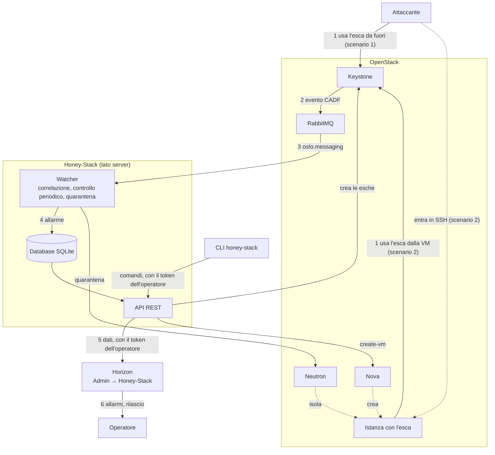

# Honey-Stack

**Rilevamento di credenziali rubate tramite honeytoken in OpenStack.**

Honey-Stack è un plugin DevStack che crea in Keystone delle **credenziali esca** (honeytoken): utenti senza ruoli e senza accesso a nessuna risorsa, che nessun utente legittimo usa. I file con queste credenziali (`clouds.yaml`, `openrc`) vengono lasciati dove un attaccante potrebbe trovarli. Chiunque provi ad autenticarsi con un'esca viene quindi segnalato in tempo reale, con indirizzo IP, orario, esito e strumento usato.

Se l'esca viene usata da un'istanza del cloud, Honey-Stack indica quale istanza è stata compromessa e la **isola automaticamente** dalla rete.

Progetto per l'esame di Piattaforme di Cloud Computing, Laurea Magistrale LM-66, Università di Salerno.

## Architettura


| Componente | Modulo | Ruolo |
| --- | --- | --- |
| Watcher | `honeystack/watcher.py` | riceve da RabbitMQ gli eventi CADF `identity.authenticate` di Keystone e tiene solo quelli delle esche |
| Correlazione | `honeystack/correlazione.py` | collega gli allarmi dallo stesso IP: brute force e ricognizione |
| Controllo periodico | `honeystack/controllo.py` | verifica che le esche restino senza ruoli né gruppi, abilitate ed esistenti |
| Quarantena | `honeystack/quarantena.py` | isola via Neutron l'istanza da cui è stata usata un'esca, con rilascio |
| Database | `honeystack/db.py` | SQLite con esche, allarmi e quarantene |
| Gestore delle esche | `honeystack/manager.py` | lato server, usato dalle API: crea e rimuove le esche in Keystone, genera i file esca, crea le istanze con l'esca |
| API REST | `honeystack/app.py` | API Flask per esche, allarmi e quarantene, unico punto di accesso per i client; ogni richiesta porta un token Keystone con ruolo admin |
| CLI | `honeystack/cli.py` | comando `honey-stack`: client delle API REST, con le credenziali dell'operatore (`openrc`) |
| Pannelli Horizon | `honeystack_dashboard/` | gruppo **Honey-Stack** nella dashboard Admin di Horizon: pannelli Allarmi, Honeytoken e Quarantene, che leggono le API con il token dell'utente entrato in Horizon |
| Accesso a OpenStack | `honeystack/cloud.py` | tutte le chiamate a Keystone, Nova, Glance e Neutron tramite `openstacksdk` |
| Configurazione | `honeystack/config.py` | opzioni con `oslo.config`, log con `oslo.log` |
| Plugin DevStack | `devstack/plugin.sh`, `devstack/settings` | installazione, configurazione e avvio con `./stack.sh`, compresa l'aggiunta dei pannelli a Horizon |

Solo i due servizi lato server, il watcher e le API REST, usano il database e l'utente di servizio. I client, cioè i pannelli di Horizon e il comando `honey-stack`, passano sempre dalle API con il token dell'operatore, come fanno Horizon e il client `openstack` con le API degli altri servizi.

Honey-Stack usa solo le API pubbliche di OpenStack: non modifica il codice di nessun servizio. Anche i pannelli si aggiungono a Horizon con il suo meccanismo dei plugin (file `enabled`), senza toccarne il codice.

## Come funziona

1. **Creazione dell'esca.** L'amministratore crea un honeytoken da Horizon (Admin → Honey-Stack → Honeytoken) o con `honey-stack create`. Honey-Stack crea in Keystone un utente nel progetto isolato `infra-ops`, senza ruoli e con una password casuale, e genera i file esca.
2. **L'esca viene lasciata in giro**: su un PC, in un repository, in un backup, oppure dentro un'istanza del cloud con `honey-stack create-vm`.
3. **L'attaccante la usa.** Per ogni tentativo di accesso Keystone pubblica su RabbitMQ un evento in formato CADF (Cloud Auditing Data Federation, lo standard di audit adottato da OpenStack), con utente, esito, IP e strumento.
4. **Il watcher la riconosce** e salva un allarme: **ATTENZIONE** se la password era sbagliata, **GRAVE** se era giusta, cioè se chi la usa ha letto davvero il file esca.
5. **Correlazione e risposta.** Gli allarmi dallo stesso IP vengono correlati. Se l'accesso riuscito parte da un'istanza del cloud, l'istanza viene messa in quarantena.
6. **L'operatore** vede tutto in Horizon, nei pannelli Admin → Honey-Stack, e decide se rilasciare l'istanza.

## Funzionalità

- **Honeytoken in Keystone**: utenti esca senza ruoli in un progetto isolato, con i file `clouds.yaml` e `openrc` da scaricare.
- **Allarmi in tempo reale** con gravità, IP sorgente, orario, esito e strumento (user agent).
- **Esca dentro un'istanza**: `honey-stack create-vm` crea un'istanza Nova e, tramite uno script di avvio (user-data), scrive l'esca in `~/.config/openstack/clouds.yaml`. L'allarme indica quale istanza è stata compromessa.
- **Quarantena automatica**: se un'esca viene usata con successo da un'istanza, i suoi security group sono sostituiti da un gruppo senza regole, che blocca tutto il traffico (anche le connessioni già aperte). L'istanza resta accesa per l'analisi; il rilascio ripristina i gruppi originali.
- **Correlazione degli attacchi**: brute force (5 password sbagliate in 5 minuti dallo stesso IP) e ricognizione (2 o più esche diverse dallo stesso IP).
- **Controllo periodico delle esche** (ogni 60 s): ogni manomissione di un'esca genera un allarme. Se riceve un ruolo o un gruppo, Honey-Stack lo toglie; se viene disabilitata, la riattiva; se viene cancellata, la segnala e la disattiva.
- **Integrazione con OpenStack**: pannelli nella dashboard Admin di Horizon, servizio `deception` nel catalogo di Keystone, utente di servizio dedicato, configurazione con `oslo.config`, log con `oslo.log`, servizi systemd gestiti da DevStack.

## Installazione

Requisiti: DevStack (provato con la versione 2027.1 su Ubuntu 24.04).

Aggiungere a `/opt/stack/devstack/local.conf`:

```ini
[[local|localrc]]
enable_plugin honey-stack https://github.com/BenedettoPio/honey-stack main
```

Un esempio completo è in [`devstack/local.conf.sample`](devstack/local.conf.sample). Poi:

```bash
cd /opt/stack/devstack
./stack.sh
```

L'installazione è stata verificata da zero su una DevStack pulita, usando solo `devstack/local.conf.sample`, prima dell'integrazione con Horizon. I pannelli di Horizon sono stati provati su una DevStack già installata, copiando in Horizon gli stessi file `enabled` che il plugin copia durante `./stack.sh`.

Il plugin, durante `./stack.sh`:

- installa il pacchetto Python nell'ambiente di DevStack;
- attiva in Keystone le notifiche CADF su RabbitMQ (anche per gli accessi riusciti);
- crea l'utente di servizio `honey-stack`, il progetto delle esche `infra-ops` e il servizio `deception` nel catalogo, con endpoint sulla porta 5050;
- scrive la configurazione in `/etc/honey-stack/honey-stack.conf`;
- se Horizon è attivo, copia i file `enabled` dei pannelli in `/opt/stack/horizon/openstack_dashboard/local/enabled/`. Lo fa nella fase `post-config`, che DevStack esegue prima di preparare i file statici di Horizon e di riavviare Apache: così i pannelli compaiono senza altri passi;
- avvia i servizi `devstack@honey-stack-watcher` e `devstack@honey-stack-dashboard` (quest'ultimo serve le API REST). All'avvio il watcher attende che RabbitMQ sia raggiungibile e le API che lo sia Keystone, riprovando finché non lo sono.

Un nuovo `./stack.sh` ricrea Keystone da zero, quindi le esche registrate in precedenza non esistono più: il plugin sposta il database e i file esca precedenti in una cartella con la data (`/opt/stack/data/honey-stack.<data>`) e riparte vuoto.

Variabili facoltative di `local.conf`: `HONEYSTACK_PORT` (predefinita `5050`) e `HONEYSTACK_DECOY_PROJECT` (predefinito `infra-ops`).

Verifica:

```bash
systemctl is-active devstack@honey-stack-watcher devstack@honey-stack-dashboard
source /opt/stack/devstack/openrc admin admin
openstack catalog list | grep -A2 deception
```

## Uso

### Comandi

Il comando `honey-stack` è un client delle API REST: usa le credenziali dell'ambiente (`source /opt/stack/devstack/openrc admin admin`) e trova l'indirizzo delle API nel catalogo di Keystone, servizio `deception`.

```bash
honey-stack create NOME [LUOGO]     # nuova esca; LUOGO = dove verrà lasciato il file
honey-stack create-vm NOME VM       # nuova istanza con l'esca al suo interno
honey-stack files NOME [CARTELLA]   # scarica clouds.yaml e openrc dell'esca
honey-stack list                    # esche attive
honey-stack delete NOME             # elimina l'esca da Keystone (non l'istanza)
honey-stack alerts                  # ultimi allarmi
honey-stack quarantine-list         # istanze in quarantena
honey-stack release VM              # rilascia un'istanza (nome, IP o ID)
```

Con DevStack il comando si trova in `/opt/stack/data/venv/bin/honey-stack`. Sul server i file esca stanno in `/opt/stack/data/honey-stack/esche/NOME/`.

Sulla macchina del servizio, `python -m honeystack.db` è lo strumento di amministrazione del database (come `keystone-manage` per Keystone): `alerts` stampa gli allarmi, `reset-alerts` mette da parte quelli delle prove dopo averne salvato una copia.

### Horizon

In Horizon (`http://<host>/dashboard`), entrando con un utente con ruolo `admin`, il gruppo **Admin → Honey-Stack** contiene tre pannelli:

- **Allarmi**: ultimi 100 allarmi con gravità (GRAVE in rosso, ATTENZIONE in giallo), orario, esca, luogo dell'esca, evento, IP sorgente e strumento. La pagina si aggiorna da sola ogni 10 secondi.
- **Honeytoken**: esche attive; permette di crearne di nuove (**Crea honeytoken**), di scaricare `clouds.yaml` e `openrc` e di eliminarle.
- **Quarantene**: istanze isolate, con l'azione **Rilascia VM**.

I pannelli compaiono solo se il servizio `deception` è nel catalogo di Keystone. Non hanno un login proprio: chiamano le API REST con il token dell'utente già entrato in Horizon, e Honey-Stack lo verifica su Keystone.

### API REST

Sulla porta 5050. Tranne `GET /`, che descrive il servizio, richiedono un token Keystone di un utente con ruolo `admin` nell'intestazione `X-Auth-Token`.

| Metodo e percorso | Risposta |
| --- | --- |
| `GET /api/v1/alerts` | ultimi 100 allarmi, con gravità e luogo dell'esca |
| `GET /api/v1/honeytokens` | esche attive |
| `POST /api/v1/honeytokens` | crea un'esca: `{"name": "...", "location": "..."}`; con `"vm": "..."` crea anche un'istanza con l'esca dentro (201; 400 nome non valido; 409 utente già esistente; 502 istanza non creata) |
| `DELETE /api/v1/honeytokens/NOME` | elimina un'esca (204; 404 se non è un'esca attiva) |
| `GET /api/v1/honeytokens/NOME/files/FILE` | scarica `clouds.yaml` o `openrc` di un'esca attiva |
| `GET /api/v1/quarantines` | istanze attualmente in quarantena |
| `POST /api/v1/quarantines/ID/release` | rilascia la quarantena con quell'ID (404 se non è attiva) |

```bash
TOKEN=$(openstack token issue -f value -c id)
curl -s -H "X-Auth-Token: $TOKEN" http://<host>:5050/api/v1/alerts
```

## Configurazione

File: `/etc/honey-stack/honey-stack.conf` (un esempio è in [`etc/honey-stack.conf.sample`](etc/honey-stack.conf.sample)). L'elenco completo delle opzioni, con la descrizione, si ottiene con:

```bash
oslo-config-generator --namespace honey-stack
```

Opzioni principali della sezione `[DEFAULT]`:

| Opzione | Predefinito | Significato |
| --- | --- | --- |
| `decoy_project` | `infra-ops` | progetto Keystone delle esche |
| `dashboard_port` | `5050` | porta delle API REST |
| `check_interval` | `60` | secondi tra un controllo delle esche e il successivo |
| `correlation_window` | `300` | finestra in secondi per la correlazione |
| `brute_force_threshold` | `5` | password sbagliate che fanno scattare il brute force |
| `vm_flavor`, `vm_network`, `vm_floating_pool` | `m1.tiny`, `private`, `public` | parametri delle istanze con l'esca |
| `quarantine_enabled` | `true` | quarantena automatica delle istanze |
| `quarantine_on_failure` | `false` | isola anche con la password sbagliata |
| `quarantine_security_group` | `honey-quarantena` | security group senza regole usato per isolare |

La sezione `[service_user]` contiene le credenziali dell'utente di servizio, scritte dal plugin. Dopo una modifica: `sudo systemctl restart devstack@honey-stack-watcher devstack@honey-stack-dashboard`.

## Test

I test automatici del servizio (110) usano `pytest` e non richiedono un cloud attivo: le chiamate a OpenStack, raccolte in `honeystack/cloud.py`, vengono sostituite da un oggetto simulato. I test del comando `honey-stack` lo fanno parlare con le API vere, senza rete, così provano tutto il percorso comando → API → gestore. Gli eventi di ingresso sono eventi CADF reali registrati da Keystone (`tests/dati/eventi_cadf.json`, estratti con `tools/estrai_eventi.py`).

```bash
cd /opt/stack/honey-stack
/opt/stack/data/venv/bin/pip install -c /opt/stack/requirements/upper-constraints.txt -r test-requirements.txt
/opt/stack/data/venv/bin/python -m pytest -q
```

I pannelli di Horizon hanno test separati (12), che usano l'ambiente di test di Horizon e sostituiscono le API REST con risposte simulate:

```bash
DJANGO_SETTINGS_MODULE=honeystack_dashboard.tests.settings \
    /opt/stack/data/venv/bin/python -m django test honeystack_dashboard.tests
```

## Demo

L'ambiente di prova è composto da una VM con DevStack e da una VM Kali Linux nel ruolo dell'attaccante. I due ruoli restano separati: su Kali gira solo l'attacco, così negli allarmi compare l'indirizzo di chi attacca; Horizon, cioè la vista del difensore, è aperto sulla DevStack (`http://localhost/dashboard`, Admin → Honey-Stack).

1. **Credenziali rubate dall'esterno.** L'attaccante trova un `clouds.yaml` esca e lo usa contro Keystone: un tentativo con password sbagliata genera un allarme ATTENZIONE, più tentativi ravvicinati l'allarme di brute force, la password giusta un allarme GRAVE. Usato con il client ufficiale `openstack`, il file restituisce all'attaccante un errore, perché l'esca non ha ruoli, mentre il difensore vede un allarme GRAVE.
2. **Istanza compromessa.** L'attaccante entra in SSH in un'istanza creata con `honey-stack create-vm`, trova l'esca in `~/.config/openstack/clouds.yaml` e la usa: l'allarme indica l'istanza compromessa, che viene isolata in pochi secondi. L'operatore la rilascia da Horizon.

### Preparazione

Sulla DevStack, come utente `stack`, una volta sola:

```bash
source /opt/stack/devstack/openrc admin admin
/opt/stack/data/venv/bin/honey-stack create svc_backup "PC dello sviluppatore"
/opt/stack/data/venv/bin/honey-stack create-vm svc_deploy web-01
```

Prima di ogni demo (rimette l'indirizzo di `br-ex`, controlla i servizi, le API e i pannelli di Horizon, accende l'istanza e la rilascia se è rimasta in quarantena; con `--azzera-allarmi` mette da parte gli allarmi delle prove, dopo averne salvato una copia):

```bash
demo/prepara.sh --azzera-allarmi
```

Su Kali si scarica il repository. Il `clouds.yaml` di `svc_backup` viene copiato su Kali in `~/Downloads` dal difensore, prima della demo (ad esempio scaricandolo da Horizon, pannello Honeytoken): rappresenta l'esca lasciata sul PC di uno sviluppatore, che l'attaccante trova. Durante la demo l'attaccante non conosce le credenziali di Horizon.

```bash
git clone https://github.com/BenedettoPio/honey-stack
cd honey-stack
demo/demo.sh check
```

Su Kali servono `curl`, `ssh` e `ping`. `demo/demo.sh check` controlla che Keystone, Horizon, le API di Honey-Stack e l'istanza siano raggiungibili, aggiunge se manca la rotta verso la rete `public` di DevStack (`172.24.4.0/24` attraverso la DevStack) e installa `sshpass`, usato per entrare nell'istanza CirrOS. Il client ufficiale `openstack` è facoltativo: se è presente, lo scenario 1 lo usa per il tentativo più realistico.

```bash
sudo apt update && sudo apt install -y python3-openstackclient
```

Gli script usano gli indirizzi del laboratorio in cui sono stati provati: DevStack su `192.168.206.131`, istanza `web-01` con floating IP `172.24.4.124`, utente CirrOS `cirros`. In un altro ambiente si indicano con le variabili `DEMO_DEVSTACK`, `DEMO_VM_IP`, `DEMO_VM_USER` e `DEMO_VM_PASSWORD` (sulla DevStack: `DEMO_VM`), ad esempio `DEMO_VM_IP=172.24.4.200 demo/demo.sh scenario2`.

### Esecuzione

[`demo/demo.sh`](demo/demo.sh), su Kali:

```bash
demo/demo.sh scenario1 ~/Downloads/clouds.yaml   # credenziali rubate dall'esterno
demo/demo.sh scenario2                           # istanza compromessa, quarantena e rilascio
demo/demo.sh all ~/Downloads/clouds.yaml         # controlli ed entrambi gli scenari
```

Lo script stampa ogni comando prima di eseguirlo, indica cosa osservare nei pannelli di Horizon e si ferma tra un passo e l'altro (`demo/demo.sh --no-pause …` non si ferma). Nello scenario 2 attende che l'operatore rilasci l'istanza dal pannello Quarantene. Indirizzi e nomi si possono cambiare con le variabili `DEMO_*` descritte in testa allo script.

## Scelte di sicurezza

- **Le esche non danno accesso a nulla.** Sono utenti di Keystone senza ruoli né gruppi, in un progetto dedicato (`infra-ops`), con una password casuale di 20 caratteri. Anche chi le usa con successo non ottiene risorse: ottiene solo un allarme a suo carico.
- **Un'esca non può diventare un accesso vero.** Il controllo periodico toglie ruoli e gruppi assegnati a un'esca, per errore o da un attaccante, e ne segnala la disattivazione o la cancellazione.
- **Gravità basata sull'esito.** Una password sbagliata può essere un tentativo a caso (ATTENZIONE); una password giusta prova che qualcuno ha letto il file esca (GRAVE).
- **Quarantena solo quando la compromissione è certa.** Di base l'isolamento scatta solo con la password giusta, perché isolare un'istanza per errore significa interrompere un servizio; `quarantine_on_failure` permette di essere più severi. L'istanza non viene spenta né cancellata, per non perdere ciò che serve all'analisi, e il rilascio resta una decisione dell'operatore.
- **Gruppo di quarantena davvero vuoto.** Neutron aggiunge a ogni nuovo security group le regole che permettono tutto il traffico in uscita: Honey-Stack le cancella, così l'istanza isolata non può nemmeno contattare l'esterno.
- **Credenziali del servizio protette.** Honey-Stack usa un utente di servizio dedicato (con ruolo `admin`, necessario per gestire utenti e istanze di altri progetti). La sua password sta in `/etc/honey-stack/honey-stack.conf` con permessi `600` e il plugin la nasconde dal log di `stack.sh`.
- **Un solo punto di accesso.** Database e utente di servizio li usano solo il watcher e le API, cioè il lato server. Horizon e il comando `honey-stack` sono client delle API e usano il token dell'operatore: ogni operazione passa dagli stessi controlli (token, ruolo admin, nomi validi).
- **Accesso solo per amministratori.** I pannelli stanno nella dashboard Admin di Horizon, che ha già il suo login, le sue sessioni e la protezione CSRF dei form; le API verificano su Keystone, a ogni richiesta, che il token abbia il ruolo `admin`. Honey-Stack non ha più un'interfaccia web con login proprio.
- **Nomi delle esche controllati.** Il nome di un'esca diventa un utente di Keystone e il nome di una cartella: API e pannello accettano solo lettere, cifre e `_ . -`, e i file si scaricano solo per esche attive, così una richiesta non può uscire dalla cartella delle esche.
- **Limiti noti.** Le API usano il server di sviluppo di Flask, in HTTP: va bene per un ambiente di laboratorio come DevStack, non per la produzione, dove andrebbero messe dietro Apache con TLS come gli altri servizi.

## Struttura del repository

```
devstack/        plugin DevStack (plugin.sh, settings, local.conf.sample)
demo/            script della demo (demo.sh su Kali, prepara.sh sulla DevStack)
etc/             esempio del file di configurazione
honeystack/      codice del servizio (watcher, API REST, CLI)
honeystack_dashboard/  pannelli di Horizon (Admin -> Honey-Stack) e loro test
tests/           test automatici ed eventi CADF reali
tools/           estrazione degli eventi CADF dal log del watcher
```

## Licenza

Apache License 2.0, vedi [`LICENSE`](LICENSE).
