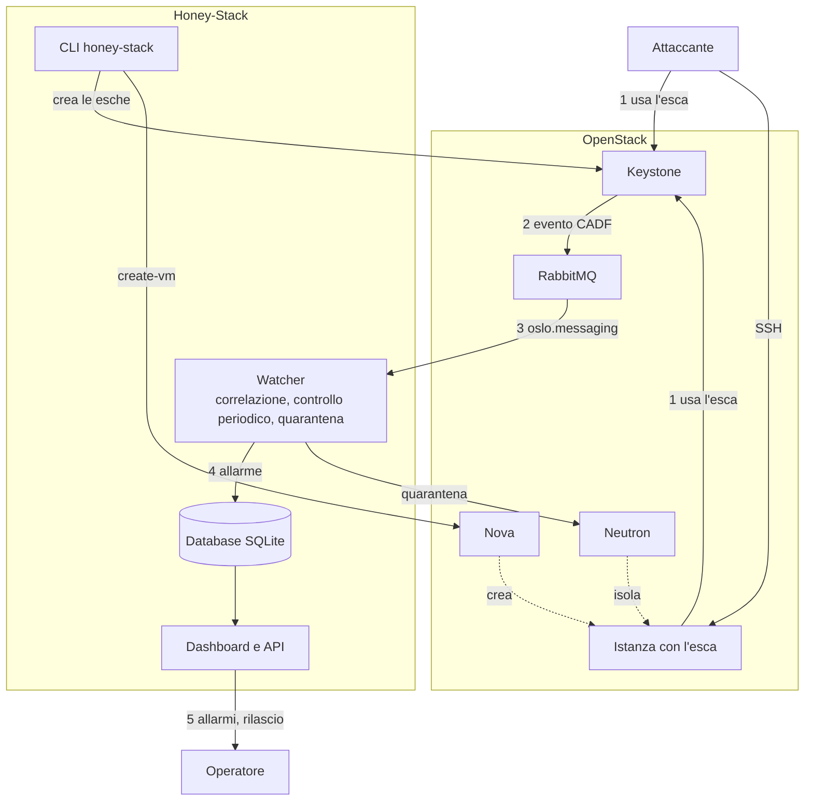

# Honey-Stack

**Rilevamento di credenziali rubate tramite honeytoken in OpenStack.**

Honey-Stack è un plugin DevStack che crea in Keystone delle **credenziali esca** (honeytoken): utenti senza ruoli e senza accesso a nessuna risorsa, che nessun utente legittimo usa. I file con queste credenziali (`clouds.yaml`, `openrc`) vengono lasciati dove un attaccante potrebbe trovarli. Chiunque provi ad autenticarsi con un'esca viene quindi segnalato in tempo reale, con indirizzo IP, orario, esito e strumento usato.

Se l'esca viene usata da un'istanza del cloud, Honey-Stack indica quale istanza è stata compromessa e la **isola automaticamente** dalla rete.

Progetto per l'esame di Piattaforme di Cloud Computing, Laurea Magistrale LM-66, Università di Salerno.

## Architettura



| Componente | Modulo | Ruolo |
| --- | --- | --- |
| Watcher | `honeystack/watcher.py` | riceve da RabbitMQ gli eventi CADF `identity.authenticate` di Keystone e tiene solo quelli delle esche |
| Correlazione | `honeystack/correlazione.py` | collega gli allarmi dallo stesso IP: brute force e ricognizione |
| Controllo periodico | `honeystack/controllo.py` | verifica che le esche restino senza ruoli né gruppi, abilitate ed esistenti |
| Quarantena | `honeystack/quarantena.py` | isola via Neutron l'istanza da cui è stata usata un'esca, con rilascio |
| Database | `honeystack/db.py` | SQLite con esche, allarmi e quarantene |
| Gestore | `honeystack/manager.py` | comando `honey-stack`: crea e rimuove le esche, genera i file esca |
| Dashboard e API | `honeystack/app.py` | interfaccia Flask e API REST, accesso con Keystone (ruolo admin) |
| Accesso a OpenStack | `honeystack/cloud.py` | tutte le chiamate a Keystone, Nova e Neutron tramite `openstacksdk` |
| Configurazione | `honeystack/config.py` | opzioni con `oslo.config`, log con `oslo.log` |
| Plugin DevStack | `devstack/plugin.sh`, `devstack/settings` | installazione, configurazione e avvio con `./stack.sh` |

Honey-Stack usa solo le API pubbliche di OpenStack: non modifica il codice di nessun servizio.

## Come funziona

1. **Creazione dell'esca.** L'amministratore crea un honeytoken dalla dashboard o con `honey-stack create`. Honey-Stack crea in Keystone un utente nel progetto isolato `infra-ops`, senza ruoli e con una password casuale, e genera i file esca.
2. **L'esca viene lasciata in giro**: su un PC, in un repository, in un backup, oppure dentro un'istanza del cloud con `honey-stack create-vm`.
3. **L'attaccante la usa.** Per ogni tentativo di accesso Keystone pubblica su RabbitMQ un evento in formato CADF (Cloud Auditing Data Federation, lo standard di audit adottato da OpenStack), con utente, esito, IP e strumento.
4. **Il watcher la riconosce** e salva un allarme: **ATTENZIONE** se la password era sbagliata, **GRAVE** se era giusta, cioè se chi la usa ha letto davvero il file esca.
5. **Correlazione e risposta.** Gli allarmi dallo stesso IP vengono correlati. Se l'accesso riuscito parte da un'istanza del cloud, l'istanza viene messa in quarantena.
6. **L'operatore** vede tutto nella dashboard e decide se rilasciare l'istanza.

## Funzionalità

- **Honeytoken in Keystone**: utenti esca senza ruoli in un progetto isolato, con i file `clouds.yaml` e `openrc` da scaricare.
- **Allarmi in tempo reale** con gravità, IP sorgente, orario, esito e strumento (user agent).
- **Esca dentro un'istanza**: `honey-stack create-vm` crea un'istanza Nova e, tramite uno script di avvio (user-data), scrive l'esca in `~/.config/openstack/clouds.yaml`. L'allarme indica quale istanza è stata compromessa.
- **Quarantena automatica**: se un'esca viene usata con successo da un'istanza, i suoi security group sono sostituiti da un gruppo senza regole, che blocca tutto il traffico (anche le connessioni già aperte). L'istanza resta accesa per l'analisi; il rilascio ripristina i gruppi originali.
- **Correlazione degli attacchi**: brute force (5 password sbagliate in 5 minuti dallo stesso IP) e ricognizione (2 o più esche diverse dallo stesso IP).
- **Controllo periodico delle esche** (ogni 60 s): se un'esca riceve un ruolo o un gruppo, viene disattivata o cancellata, Honey-Stack genera un allarme e ripristina lo stato corretto.
- **Integrazione con OpenStack**: servizio `deception` nel catalogo di Keystone, utente di servizio dedicato, configurazione con `oslo.config`, log con `oslo.log`, servizi systemd gestiti da DevStack.

## Installazione

Requisiti: DevStack (provato con la versione 2027.1 su Ubuntu 24.04).

Aggiungere a `/opt/stack/devstack/local.conf`:

```ini
[[local|localrc]]
enable_plugin honey-stack https://github.com/BenedettoPio/honey-stack main
```

Un esempio completo è in [`devstack/local.conf.sample`](devstack/local.conf.sample). Poi:

```bash
cd /opt/stack/devstack
./stack.sh
```

L'installazione è stata verificata da zero su una DevStack pulita, usando solo `devstack/local.conf.sample`.

Il plugin, durante `./stack.sh`:

- installa il pacchetto Python nell'ambiente di DevStack;
- attiva in Keystone le notifiche CADF su RabbitMQ (anche per gli accessi riusciti);
- crea l'utente di servizio `honey-stack`, il progetto delle esche `infra-ops` e il servizio `deception` nel catalogo, con endpoint sulla porta 5050;
- scrive la configurazione in `/etc/honey-stack/honey-stack.conf`;
- avvia i servizi `devstack@honey-stack-watcher` e `devstack@honey-stack-dashboard`.

Variabili facoltative di `local.conf`: `HONEYSTACK_PORT` (predefinita `5050`) e `HONEYSTACK_DECOY_PROJECT` (predefinito `infra-ops`).

Verifica:

```bash
systemctl is-active devstack@honey-stack-watcher devstack@honey-stack-dashboard
source /opt/stack/devstack/openrc admin admin
openstack catalog list | grep -A2 deception
```

## Uso

### Comandi

```bash
honey-stack create NOME [LUOGO]     # nuova esca; LUOGO = dove verrà lasciato il file
honey-stack create-vm NOME VM       # nuova istanza con l'esca al suo interno
honey-stack list                    # esche attive
honey-stack delete NOME             # elimina l'esca da Keystone (non l'istanza)
honey-stack quarantine-list         # istanze in quarantena
honey-stack release VM              # rilascia un'istanza (nome, IP o ID)
```

Con DevStack il comando si trova in `/opt/stack/data/venv/bin/honey-stack`. I file esca vengono scritti in `/opt/stack/data/honey-stack/esche/NOME/`.

### Dashboard

`http://<host>:5050`, con le credenziali di un utente OpenStack con ruolo `admin`. Mostra gli allarmi per gravità, le istanze in quarantena (con il pulsante **Rilascia**) e le esche attive, e permette di creare esche e scaricare i file esca.

### API REST

Richiedono un token Keystone di un utente con ruolo `admin` nell'intestazione `X-Auth-Token`.

| Metodo e percorso | Risposta |
| --- | --- |
| `GET /api/v1/alerts` | ultimi 100 allarmi, con gravità |
| `GET /api/v1/honeytokens` | esche attive |
| `GET /api/v1/quarantines` | istanze attualmente in quarantena |

```bash
TOKEN=$(openstack token issue -f value -c id)
curl -s -H "X-Auth-Token: $TOKEN" http://<host>:5050/api/v1/alerts
```

## Configurazione

File: `/etc/honey-stack/honey-stack.conf` (un esempio è in [`etc/honey-stack.conf.sample`](etc/honey-stack.conf.sample)). L'elenco completo delle opzioni, con la descrizione, si ottiene con:

```bash
oslo-config-generator --namespace honey-stack
```

Opzioni principali della sezione `[DEFAULT]`:

| Opzione | Predefinito | Significato |
| --- | --- | --- |
| `decoy_project` | `infra-ops` | progetto Keystone delle esche |
| `dashboard_port` | `5050` | porta della dashboard e delle API |
| `check_interval` | `60` | secondi tra un controllo delle esche e il successivo |
| `correlation_window` | `300` | finestra in secondi per la correlazione |
| `brute_force_threshold` | `5` | password sbagliate che fanno scattare il brute force |
| `vm_flavor`, `vm_network`, `vm_floating_pool` | `m1.tiny`, `private`, `public` | parametri delle istanze con l'esca |
| `quarantine_enabled` | `true` | quarantena automatica delle istanze |
| `quarantine_on_failure` | `false` | isola anche con la password sbagliata |
| `quarantine_security_group` | `honey-quarantena` | security group senza regole usato per isolare |

La sezione `[service_user]` contiene le credenziali dell'utente di servizio, scritte dal plugin. Dopo una modifica: `sudo systemctl restart devstack@honey-stack-watcher devstack@honey-stack-dashboard`.

## Test

I test automatici (81) usano `pytest` e non richiedono un cloud attivo: le chiamate a OpenStack, raccolte in `honeystack/cloud.py`, vengono sostituite da un oggetto simulato. Gli eventi di ingresso sono eventi CADF reali registrati da Keystone (`tests/dati/eventi_cadf.json`, estratti con `tools/estrai_eventi.py`).

```bash
cd /opt/stack/honey-stack
/opt/stack/data/venv/bin/pip install -c /opt/stack/requirements/upper-constraints.txt -r test-requirements.txt
/opt/stack/data/venv/bin/python -m pytest -q
```

## Demo

L'ambiente di prova è composto da una VM con DevStack e da una VM Kali Linux nel ruolo dell'attaccante. I due ruoli restano separati: su Kali gira solo l'attacco, così negli allarmi compare l'indirizzo di chi attacca; la dashboard, cioè la vista del difensore, è aperta sulla DevStack (`http://localhost:5050`).

1. **Credenziali rubate dall'esterno.** L'attaccante trova un `clouds.yaml` esca e lo usa contro Keystone: un tentativo con password sbagliata genera un allarme ATTENZIONE, più tentativi ravvicinati l'allarme di brute force, la password giusta un allarme GRAVE.
2. **Istanza compromessa.** L'attaccante entra in SSH in un'istanza creata con `honey-stack create-vm`, trova l'esca in `~/.config/openstack/clouds.yaml` e la usa: l'allarme indica l'istanza compromessa, che viene isolata in pochi secondi. L'operatore la rilascia dalla dashboard.

### Preparazione

Sulla DevStack, come utente `stack`, una volta sola:

```bash
source /opt/stack/devstack/openrc admin admin
/opt/stack/data/venv/bin/honey-stack create svc_backup "PC dello sviluppatore"
/opt/stack/data/venv/bin/honey-stack create-vm svc_deploy web-01
```

Prima di ogni demo (rimette l'indirizzo di `br-ex`, controlla i servizi, accende l'istanza e la rilascia se è rimasta in quarantena; con `--azzera-allarmi` mette da parte gli allarmi delle prove, dopo averne salvato una copia):

```bash
demo/prepara.sh --azzera-allarmi
```

Su Kali si scarica il repository. Il `clouds.yaml` di `svc_backup` viene copiato su Kali in `~/Downloads` dal difensore, prima della demo (ad esempio scaricandolo dalla dashboard): rappresenta l'esca lasciata sul PC di uno sviluppatore, che l'attaccante trova. Durante la demo l'attaccante non conosce le credenziali della dashboard.

```bash
git clone https://github.com/BenedettoPio/honey-stack
cd honey-stack
demo/demo.sh check
```

### Esecuzione

[`demo/demo.sh`](demo/demo.sh), su Kali:

```bash
demo/demo.sh scenario1 ~/Downloads/clouds.yaml   # credenziali rubate dall'esterno
demo/demo.sh scenario2                           # istanza compromessa, quarantena e rilascio
demo/demo.sh all ~/Downloads/clouds.yaml         # controlli ed entrambi gli scenari
```

Lo script stampa ogni comando prima di eseguirlo, indica cosa osservare nella dashboard e si ferma tra un passo e l'altro (`demo/demo.sh --no-pause …` non si ferma). Nello scenario 2 attende che l'operatore rilasci l'istanza dalla dashboard. Indirizzi e nomi si possono cambiare con le variabili `DEMO_*` descritte in testa allo script.

## Struttura del repository

```
devstack/        plugin DevStack (plugin.sh, settings, local.conf.sample)
demo/            script della demo (demo.sh su Kali, prepara.sh sulla DevStack)
etc/             esempio del file di configurazione
honeystack/      codice del servizio
tests/           test automatici ed eventi CADF reali
tools/           estrazione degli eventi CADF dal log del watcher
```

## Licenza

Apache License 2.0, vedi [`LICENSE`](LICENSE).
